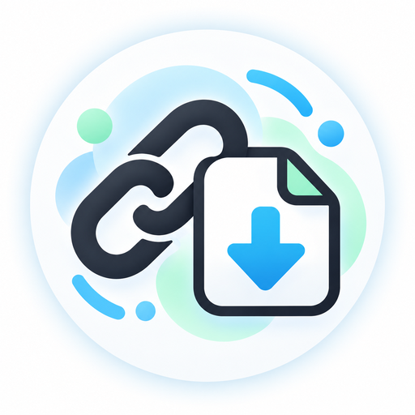

<p align="center">
  
</p>

<h1 align="center">
  
  ytdlbot · приватный видеобот
</h1>

<p align="center">
  <b>Отправьте ссылку и получите видео прямо в Telegram.</b><br>
  VK · Одноклассники · YouTube · Rutube · Дзен и сотни других сайтов
</p>

<p align="center">
  <a href="LICENSE"></a>
  
  
  
  
</p>

---

## Зачем это нужно

Скачать видео из VK или Одноклассников на удивление сложно, особенно если вы не айтишник.
Сайты-«качалки» обвешаны рекламой. Публичные Telegram-боты требуют подписаться на каналы,
вводят лимиты, пропадают, и все ваши ссылки проходят через чужой сервер.

**ytdlbot** — это ваш собственный бот. Он работает на домашнем компьютере или недорогом VPS,
пускает только тех, кого вы добавили, и устроен так просто, что разберётся даже бабушка:

> 1️⃣ скопировать ссылку → 2️⃣ отправить боту → 3️⃣ смотреть видео прямо в чате

## Возможности

- 🔒 **Приватный.** Пользоваться ботом могут только владелец и люди из списка. Незнакомец увидит лишь свой Telegram ID, чтобы попросить доступ.
- 🇷🇺 **Полностью на русском.** Понятные сообщения, прогресс-бар, меню настроек и объяснение ошибок человеческим языком.
- 🎬 **Видео до 2 ГБ.** Работает через MTProto, без ограничения Bot API в 50 МБ. Ролик можно смотреть сразу в Telegram.
- ⚙️ **Качество одной кнопкой.** 1080p, 720p или 480p для любого сайта, чтобы длинный фильм поместился в Telegram.
- 🔗 **Ссылка внутри текста.** Можно переслать сообщение вида «смотри, https://vk.com/…», бот сам найдёт ссылку.
- 🔄 **Всегда свежий yt-dlp.** Используется nightly-сборка с ежедневным автообновлением: когда VK или OK что-то меняют, исправление приходит само.
- 📦 **Один контейнер.** Никаких MySQL и Redis: SQLite и кэш в памяти. Запуск одной командой.

## Как это выглядит

```text
Вы:   https://vk.com/video-12345_67890

Бот:  ⬇️ Скачиваю видео…
      Символические смыслы в конфликтах. Сцена из фильма «Развод по-американски»
      ▓▓▓▓░░░░░░ 42%
      200.3 МБ из 476.8 МБ
      Скорость: 2.4 МБ/с
      Осталось: 02:11

Бот:  🎬 Символические смыслы в конфликтах. Сцена из фильма «Развод по-американски»
      ⏱ 12:34   📐 1280×720
      🔗 https://vk.com/video-12345_67890
      ✅ Готово!
```

Меню команд (кнопка «/» в Telegram):

| Команда     | Что делает                                     |
|-------------|------------------------------------------------|
| `/start`    | Короткая инструкция                            |
| `/settings` | Качество видео и способ отправки (видео, файл, звук) |
| `/help`     | Помощь и ответы на частые вопросы              |

## Быстрый старт

```bash
git clone https://github.com/yinon-mitin/ytdlbot.git && cd ytdlbot
cp .env.example .env        # впишите токен бота, APP_ID/APP_HASH и свой Telegram ID
docker compose up -d --build
```

📖 **Подробная инструкция:** [docs/INSTALL.md](docs/INSTALL.md). Там описано, где взять ключи, как добавить пользователей, обновляться и решать типичные проблемы.

## Благодарности и лицензия

Проект основан на [**ytdlbot**](https://github.com/tgbot-collection/ytdlbot) от
[Benny (@BennyThink)](https://github.com/BennyThink) и сообщества
[tgbot-collection](https://github.com/tgbot-collection). Большое спасибо автору за отличную основу.

Что изменено относительно оригинала: приватный режим для всех команд, русский интерфейс,
поддержка качества и полных названий для VK и OK, автообновление yt-dlp nightly и упрощённый
запуск в одном контейнере. Подробнее — в файле [NOTICE](NOTICE) и в [истории коммитов](https://github.com/yinon-mitin/ytdlbot/commits/master).

Распространяется по лицензии [Apache License 2.0](LICENSE), как и оригинальный проект.

Скачивайте только то, на что у вас есть право: уважайте авторов видео и правила сайтов.
