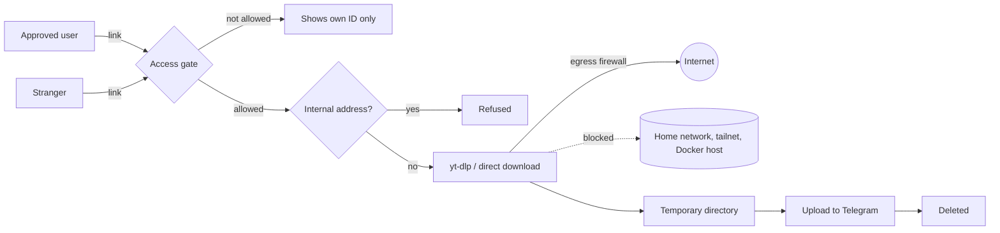

<a id="top"></a>
<div align="center">
  

  [](https://github.com/yinon-mitin/iris/actions/workflows/validate.yml)
  [](README.md)
  [](README.ru.md)
  [](LICENSE)
  [](Dockerfile)
  [](https://github.com/yt-dlp/yt-dlp)
  [](https://core.telegram.org/mtproto)

  **Iris — a self-hosted, private-by-default Telegram bot: send a link, get the video, photos, music or file right in the chat.**

  [Quick start](#quick-start) · [Features](#features) · [Security](#security-model) · [Architecture](docs/ARCHITECTURE.md) · [Install guide](docs/INSTALL.md)
</div>

## Overview

**Iris** is the project's code name, after the Greek goddess of the rainbow and messenger of the gods, who carried word between worlds. The bot does the same small job: it takes something from the open web and delivers it into your Telegram chat.

Downloading a video from VK, OK.ru or Instagram is surprisingly hard for non-technical people. Download sites are full of ads; public Telegram bots demand channel subscriptions, impose limits, disappear, and see every link you send. Iris runs on your own computer or a small VPS, answers only the people you allow, and is simple enough for anyone: **copy the link → send it to the bot → watch it in the chat.**

> [!NOTE]
> The bot interface is in Russian. Iris started as a fork of [ytdlbot](https://github.com/tgbot-collection/ytdlbot) and is now developed as an independent project; see [Credits](#credits-and-license).

## Features

| | |
| --- | --- |
| 🔒 **Private** | Only the owner and approved people can use it. Access is managed from the bot: one-time `/invite` links, `/adduser`, or an **Allow** button when a stranger presses Start. |
| 🎬 **Video up to 2 GB** | Uploads through MTProto, not the 50 MB Bot API limit. YouTube, VK, OK.ru, Rutube, Dzen, TikTok, Instagram reels and [hundreds of other sites](https://github.com/yt-dlp/yt-dlp/blob/master/supportedsites.md). |
| 🖼 **Photos and albums** | Instagram photo posts and carousels arrive as a Telegram album, in post order and at full size. |
| 📄 **Any file** | A direct link to a PDF, archive, image or song is sent as a document, photo or audio track, whatever the file really is. |
| ⚙️ **Quality in one tap** | 1080p, 720p or 480p for every site, so a long film still fits into Telegram. |
| 🧹 **Nothing stored** | Downloads are deleted as soon as the upload ends. A failed upload is retried up to three times first, without resending album parts that already arrived. |
| 🔄 **Always-fresh yt-dlp** | Installs the nightly build on start and checks daily; when a site changes, the fix arrives by itself. |
| 📦 **One container** | SQLite and an in-memory cache instead of MySQL and Redis. |

### What it looks like

```text
You:  https://vk.com/video-12345_67890

Bot:  ⬇️ Скачиваю…
      Сцена из фильма
      ▓▓▓▓░░░░░░ 42%
      200.3 МБ из 476.8 МБ
      Скорость: 2.4 МБ/с
      Осталось: 02:11

Bot:  [video]
      🎬 Сцена из фильма
      ⏱ 12:34   📐 1280×720
      🔗 https://vk.com/video-12345_67890

You:  https://www.instagram.com/p/…
Bot:  [album: 7 photos]  🖼 Post by …
```

The progress message refreshes every 1.5 seconds and disappears when the file arrives, so the chat holds only the results.

## Quick start

Requirements: Docker with Compose v2, Git and Make. On macOS, [OrbStack](https://orbstack.dev) or Docker Desktop.

```sh
git clone https://github.com/yinon-mitin/iris.git
cd iris
make init
```

Fill in the first block of `.env`: `APP_ID` and `APP_HASH` from [my.telegram.org](https://my.telegram.org), `BOT_TOKEN` from [@BotFather](https://t.me/BotFather), and your Telegram ID as `OWNER`. Then:

```sh
make test
make up
make logs
```

Open the bot in Telegram, press **Start** and send a link. The [install guide](docs/INSTALL.md) covers keys, access for family and friends, bot branding and every setting.

## Security model



- **Access gate.** Every command, message and button is checked against the owner and the allow list before anything runs.
- **No access to your network.** The bot fetches whatever link it is sent, so the container firewall rejects every connection to private, loopback, link-local, CGNAT/Tailscale and Docker-host addresses, including redirects and DNS names that resolve there. The rules are set before the bot starts; if they cannot be set, the container refuses to run. The bot process itself runs without `NET_ADMIN` and cannot undo them.
- **No file retention.** Each job gets its own temporary directory, removed when the job ends, sent or not. An hourly sweep clears anything left behind by a crash.
- **No link history.** The database keeps user IDs, settings and the allow list only.

Details and limits are in [Architecture](docs/ARCHITECTURE.md) and the [security policy](SECURITY.md).

## Operations

```text
make init       Create .env, data/ and the cookies file from templates
make check      Static checks: secrets, docs, Python syntax, shell, Compose
make test       make check + build the image and run the unit tests inside it
make up         Build and start (or update) the bot
make down       Stop the bot
make restart    Restart; yt-dlp nightly is refreshed on every start
make ps         Container status
make logs       Follow the bot log
make update     git pull, then rebuild and restart
make shell      Shell inside the running container
```

Day-to-day running, updates, backups and troubleshooting: [Operations](docs/OPERATIONS.md).

## Documentation

| Topic | English | Русский |
| --- | --- | --- |
| Project overview | [README](README.md) | [README](README.ru.md) |
| Installation and settings | [Install](docs/INSTALL.md) | [Установка](docs/ru/INSTALL.md) |
| Architecture and security model | [Architecture](docs/ARCHITECTURE.md) | [Архитектура](docs/ru/ARCHITECTURE.md) |
| Running, updates, troubleshooting | [Operations](docs/OPERATIONS.md) | [Эксплуатация](docs/ru/OPERATIONS.md) |
| Contributing | [Contributing](CONTRIBUTING.md) | [Участие](CONTRIBUTING.ru.md) |
| Security policy | [Security](SECURITY.md) | [Безопасность](SECURITY.ru.md) |
| Contributors | [Contributors](CONTRIBUTORS.md) | [Контрибьюторы](CONTRIBUTORS.ru.md) |

## Contributors

Maintained by [Yinon Mitin](https://github.com/yinon-mitin), with AI-assisted engineering and documentation. The participating model and tooling are listed in [CONTRIBUTORS.md](CONTRIBUTORS.md).

## Credits and license

Iris is based on [**ytdlbot**](https://github.com/tgbot-collection/ytdlbot) by [Benny (@BennyThink)](https://github.com/BennyThink) and the [tgbot-collection](https://github.com/tgbot-collection) contributors. Many thanks for the excellent foundation. What changed is listed in [NOTICE](NOTICE).

Distributed under the [Apache License 2.0](LICENSE), like the original project. The logo and banner are original.

Download only what you have the right to: respect creators and the rules of each site.

<div align="center"><a href="#top">Back to top</a></div>
