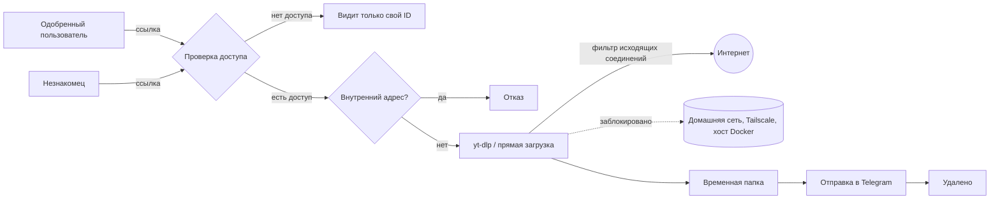

<a id="top"></a>
<div align="center">
  

  [](https://github.com/yinon-mitin/iris/actions/workflows/validate.yml)
  [](README.md)
  [](README.ru.md)
  [](LICENSE)
  [](Dockerfile)
  [](https://github.com/yt-dlp/yt-dlp)
  [](https://core.telegram.org/mtproto)

  **Iris — собственный приватный Telegram-бот: отправьте ссылку и получите видео, фото, музыку или файл прямо в чат.**

  [Быстрый старт](#быстрый-старт) · [Возможности](#возможности) · [Безопасность](#модель-безопасности) · [Архитектура](docs/ru/ARCHITECTURE.md) · [Установка](docs/ru/INSTALL.md)
</div>

## О проекте

**Iris (Ирида)** — кодовое имя проекта в честь греческой богини радуги и вестницы богов, которая переносила вести между мирами. Бот делает ту же небольшую работу: берёт что-то из интернета и доставляет в ваш чат в Telegram.

Скачать видео из VK, Одноклассников или Instagram на удивление сложно, особенно если вы не айтишник. Сайты-«качалки» обвешаны рекламой. Публичные боты требуют подписаться на каналы, вводят лимиты, пропадают, и все ваши ссылки проходят через чужой сервер. Iris работает на вашем компьютере или недорогом VPS, отвечает только тем, кого вы пустили, и устроен так просто, что разберётся каждый: **скопировать ссылку → отправить боту → смотреть прямо в чате.**

> [!NOTE]
> Интерфейс бота на русском языке. Iris начинался как форк [ytdlbot](https://github.com/tgbot-collection/ytdlbot), а теперь развивается как самостоятельный проект; см. [Благодарности](#благодарности-и-лицензия).

## Возможности

| | |
| --- | --- |
| 🔒 **Приватный** | Пользоваться могут только владелец и одобренные люди. Доступ настраивается прямо в боте: одноразовые ссылки `/invite`, команда `/adduser` или кнопка «Разрешить», когда незнакомец нажимает Start. |
| 🎬 **Видео до 2 ГБ** | Отправка через MTProto, без лимита Bot API в 50 МБ. YouTube, VK, Одноклассники, Rutube, Дзен, TikTok, рилсы Instagram и [сотни других сайтов](https://github.com/yt-dlp/yt-dlp/blob/master/supportedsites.md). |
| 🖼 **Фото и альбомы** | Фотопосты и карусели Instagram приходят альбомом, в порядке поста и в полном размере. |
| 📄 **Любой файл** | Прямая ссылка на PDF, архив, картинку или песню приходит документом, фото или аудио, смотря что это за файл на самом деле. |
| ⚙️ **Качество одной кнопкой** | 1080p, 720p или 480p для любого сайта, чтобы длинный фильм поместился в Telegram. |
| 🧹 **Ничего не хранит** | Скачанное удаляется сразу после отправки. Если отправка не удалась, бот сначала пробует ещё до трёх раз и не дублирует уже отправленные части альбома. |
| 🔄 **Всегда свежий yt-dlp** | Nightly-сборка ставится при запуске и проверяется раз в сутки: когда сайт что-то меняет, исправление приходит само. |
| 📦 **Один контейнер** | SQLite и кэш в памяти вместо MySQL и Redis. |

### Как это выглядит

```text
Вы:   https://vk.com/video-12345_67890

Бот:  ⬇️ Скачиваю…
      Сцена из фильма
      ▓▓▓▓░░░░░░ 42%
      200.3 МБ из 476.8 МБ
      Скорость: 2.4 МБ/с
      Осталось: 02:11

Бот:  [видео]
      🎬 Сцена из фильма
      ⏱ 12:34   📐 1280×720
      🔗 https://vk.com/video-12345_67890

Вы:   https://www.instagram.com/p/…
Бот:  [альбом из 7 фото]  🖼 Post by …
```

Сообщение с прогрессом обновляется каждые 1,5 секунды и исчезает, когда приходит файл: в чате остаются только результаты.

## Быстрый старт

Понадобятся Docker с Compose v2, Git и Make. На macOS — [OrbStack](https://orbstack.dev) или Docker Desktop.

```sh
git clone https://github.com/yinon-mitin/iris.git
cd iris
make init
```

Заполните первый блок `.env`: `APP_ID` и `APP_HASH` с [my.telegram.org](https://my.telegram.org), `BOT_TOKEN` от [@BotFather](https://t.me/BotFather) и свой Telegram ID в `OWNER`. Затем:

```sh
make test
make up
make logs
```

Откройте бота в Telegram, нажмите **Start** и отправьте ссылку. В [инструкции по установке](docs/ru/INSTALL.md) — где взять ключи, как дать доступ родным и друзьям, как оформить бота и все настройки.

## Модель безопасности



- **Проверка доступа.** Каждая команда, сообщение и кнопка сверяются с владельцем и списком разрешённых, прежде чем что-либо выполнится.
- **Нет доступа к вашей сети.** Бот скачивает любую присланную ссылку, поэтому фильтр контейнера отклоняет все соединения с частными, локальными, link-local, CGNAT/Tailscale-адресами и хостом Docker — в том числе через переадресации и DNS-имена, которые туда указывают. Правила ставятся до запуска бота; если поставить их не удалось, контейнер не запустится. Сам процесс бота работает без права `NET_ADMIN` и снять правила не может.
- **Файлы не хранятся.** У каждой задачи своя временная папка, она удаляется по окончании задачи, отправлен файл или нет. Раз в час уборка удаляет всё, что осталось после сбоя.
- **Нет истории ссылок.** В базе только ID пользователей, их настройки и список доступа.

Подробности и ограничения — в [Архитектуре](docs/ru/ARCHITECTURE.md) и [политике безопасности](SECURITY.ru.md).

## Управление

```text
make init       Создать .env, data/ и файл cookies из шаблонов
make check      Статические проверки: секреты, документация, синтаксис Python, shell, Compose
make test       make check + сборка образа и unit-тесты внутри него
make up         Собрать и запустить (или обновить) бота
make down       Остановить бота
make restart    Перезапустить; yt-dlp nightly обновляется при каждом запуске
make ps         Состояние контейнера
make logs       Журнал бота в реальном времени
make update     git pull, затем пересборка и перезапуск
make shell      Shell внутри работающего контейнера
```

Повседневная работа, обновления, резервные копии и решение проблем: [Эксплуатация](docs/ru/OPERATIONS.md).

## Документация

| Тема | English | Русский |
| --- | --- | --- |
| Обзор проекта | [README](README.md) | [README](README.ru.md) |
| Установка и настройки | [Install](docs/INSTALL.md) | [Установка](docs/ru/INSTALL.md) |
| Архитектура и безопасность | [Architecture](docs/ARCHITECTURE.md) | [Архитектура](docs/ru/ARCHITECTURE.md) |
| Работа, обновления, проблемы | [Operations](docs/OPERATIONS.md) | [Эксплуатация](docs/ru/OPERATIONS.md) |
| Участие в проекте | [Contributing](CONTRIBUTING.md) | [Участие](CONTRIBUTING.ru.md) |
| Политика безопасности | [Security](SECURITY.md) | [Безопасность](SECURITY.ru.md) |
| Контрибьюторы | [Contributors](CONTRIBUTORS.md) | [Контрибьюторы](CONTRIBUTORS.ru.md) |

## Контрибьюторы

Проект ведёт [Yinon Mitin](https://github.com/yinon-mitin) при участии ИИ в разработке и документации. Модель и инструменты перечислены в [CONTRIBUTORS.ru.md](CONTRIBUTORS.ru.md).

## Благодарности и лицензия

Iris основан на [**ytdlbot**](https://github.com/tgbot-collection/ytdlbot) от [Benny (@BennyThink)](https://github.com/BennyThink) и участников [tgbot-collection](https://github.com/tgbot-collection). Большое спасибо за отличную основу. Что изменено — в файле [NOTICE](NOTICE).

Распространяется по [лицензии Apache 2.0](LICENSE), как и оригинальный проект. Логотип и баннер оригинальные.

Скачивайте только то, на что у вас есть право: уважайте авторов и правила сайтов.

<div align="center"><a href="#top">Наверх</a></div>
