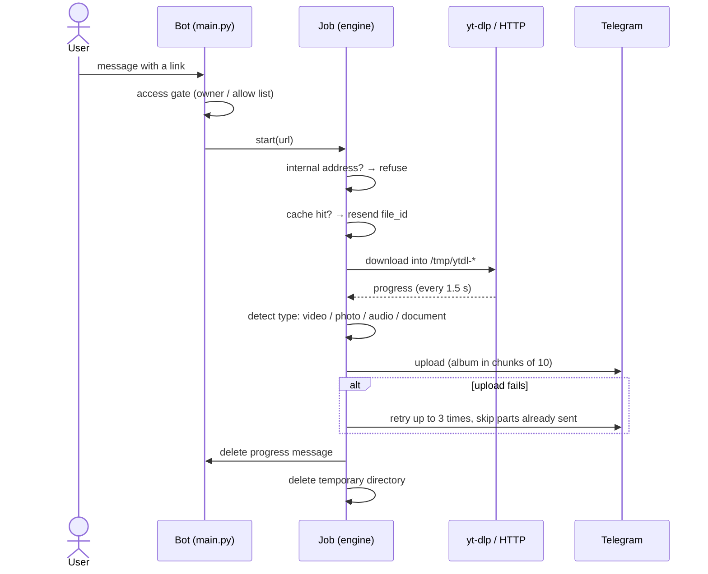

# Architecture

[English](ARCHITECTURE.md) · [Русский](ru/ARCHITECTURE.md)

Iris is a single Python process in a single container. It talks to Telegram over MTProto, downloads with yt-dlp or plain HTTP into a per-job temporary directory, uploads the result and deletes it.

## Components

| Part | Where | Role |
| --- | --- | --- |
| Entrypoint | `docker-entrypoint.sh` | Sets the egress firewall, installs yt-dlp nightly, starts the daily updater, then runs the bot without `NET_ADMIN` |
| Bot and handlers | `src/main.py` | Access gate, commands, link handling, owner tools (`/invite`, `/adduser`, …), scheduler |
| Download engines | `src/engine/` | `generic.py` (yt-dlp, any supported site and direct file links), `direct.py` (`/direct`: requests or aria2), `pixeldrain.py`, `krakenfiles.py`, `instagram.py` (`/spdl`) |
| Job lifecycle | `src/engine/base.py` | Progress, file-type detection, upload with retries, album splitting, cleanup |
| Helpers | `src/utils/` | URL checks, MIME detection, formatting, temp sweep |
| Texts | `src/config/constant.py` | Every user-facing message (Russian, HTML) |
| State | `data/` (SQLite) | Users, settings, allow list, invites |
| Cache | in-memory (or Redis) | Telegram `file_id` of single-file uploads, keyed by link + quality + format |

## Request flow

## How files are sent

The user's settings choose the quality and whether to prefer documents. The bot then sends what the file actually is, detected from its content (with the extension as a fallback):

| Downloaded | Sent as |
| --- | --- |
| Video | video (falls back to animation, audio, photo if Telegram refuses) |
| Only images | photo, or an album for several |
| Only audio | audio track |
| Anything else (PDF, archive, …) | document, with its real extension |
| Any of the above with "send as file" chosen | document |

Captions follow the type: duration and resolution for video, duration for audio, title and link for photos and files.

**Instagram.** yt-dlp extracts only videos, so a photo post failed with *No video formats found*. For Instagram links the bot lets yt-dlp download the video items, skips photo items with a match filter, then fetches each photo at full size from the post metadata. Files are numbered by position, so carousel items never overwrite each other and arrive in order.

## Upload, retries and cleanup

- **Retries.** An upload is tried up to three times with a growing pause. Flood-wait requests from Telegram are honoured. Errors that cannot improve (e.g. a file over 2 GB) are not retried.
- **Albums.** Telegram allows 10 items per album, so larger sets go out in several albums. On a retry, albums that already arrived are not sent again.
- **Cache.** Single-file results are cached by Telegram `file_id`; albums are not, because one cached ID would resend only the first item.
- **Cleanup.** Every job owns one temporary directory, removed in a `finally` block when the job ends, sent or not. An hourly scheduler job removes leftovers older than three hours, which only exist after a crash.
- **Progress.** The progress message is edited at most every 1.5 seconds. Errors while editing it (flood wait, "message not modified") pause or skip the update and never break the download. The message is deleted when the file arrives.

## Egress firewall

Iris fetches whatever link it receives. Without a guard, a link such as `http://<lan-ip>:8096/…` would make the bot read a service on your home network and send the response back as a document.

The entrypoint therefore rejects outgoing connections from the container to:

| Range | What it covers |
| --- | --- |
| `10.0.0.0/8`, `172.16.0.0/12`, `192.168.0.0/16` | Home and office networks, Docker bridge networks |
| `100.64.0.0/10` | CGNAT, including Tailscale addresses |
| `127.0.0.0/8` (except the loopback interface) | Loopback |
| `169.254.0.0/16` | Link-local, cloud metadata services |
| `0.0.0.0/8` | "This network", OrbStack host aliases |
| `192.0.0.0/24`, `192.0.2.0/24`, `198.18.0.0/15`, `198.51.100.0/24`, `203.0.113.0/24` | Special-purpose and documentation ranges |
| `224.0.0.0/4`, `240.0.0.0/4` | Multicast and reserved |
| all IPv6 except loopback | The container has no IPv6 route; blocked in case it is enabled |

Properties:

- **Covers every tool.** The rules apply to the whole container network namespace: yt-dlp, requests, aria2 and ffmpeg alike, including HTTP redirects and DNS names that resolve to internal addresses.
- **Fails closed.** If the rules cannot be installed (for example `NET_ADMIN` is missing), the container exits instead of running unprotected.
- **Cannot be undone by the bot.** The bot is started through `setpriv` with `NET_ADMIN` removed from its capability bounding set.
- **Clear answers.** Before downloading, the bot resolves the link's host; internal addresses get a short refusal instead of a network error.

DNS keeps working because Docker's resolver lives on the loopback interface (`127.0.0.11`), which stays open. Internet and Telegram traffic is unaffected.

## State and privacy

| Data | Location | In Git |
| --- | --- | --- |
| Secrets and settings | `.env` | no |
| Users, settings, allow list, invites | `data/*.db` | no |
| YouTube cookies (optional) | `youtube-cookies.txt` | no |
| Downloads | `/tmp/ytdl-*` inside the container, minutes at most | no |
| Telegram session | inside the container, recreated on rebuild | no |

The database stores no links and no download history. Links appear only in the container log, which is size-limited (3 × 10 MB) by the Compose logging options.

## Known limits

- Telegram uploads are limited to 2 GB per file.
- Web pages that are not media (articles, profiles) are not supported; only media and direct file links are.
- Some sites need an account: Reddit and private or age-restricted videos require cookies.
- Image-only posts on X/Twitter and TikTok photo slideshows are not handled like Instagram yet.
- There are no daily download limits; anyone allowed can use all workers. Keep access invite-based.
