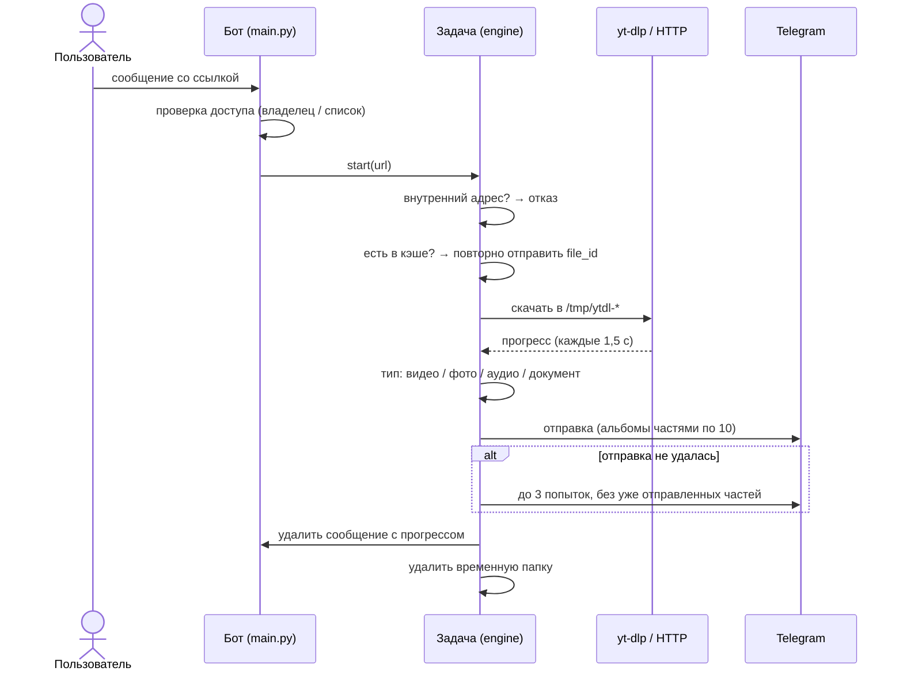

# Архитектура

[English](../ARCHITECTURE.md) · [Русский](ARCHITECTURE.md)

Iris — один процесс Python в одном контейнере. Он общается с Telegram по MTProto, скачивает через yt-dlp или обычный HTTP во временную папку задачи, отправляет результат и удаляет его.

## Компоненты

| Часть | Где | Роль |
| --- | --- | --- |
| Точка входа | `docker-entrypoint.sh` | Ставит фильтр исходящих соединений, устанавливает yt-dlp nightly, запускает ежедневное обновление, затем запускает бота без `NET_ADMIN` |
| Бот и обработчики | `src/main.py` | Проверка доступа, команды, обработка ссылок, команды владельца (`/invite`, `/adduser`, …), планировщик |
| Загрузчики | `src/engine/` | `generic.py` (yt-dlp: любые поддерживаемые сайты и прямые ссылки на файлы), `direct.py` (`/direct`: requests или aria2), `pixeldrain.py`, `krakenfiles.py`, `instagram.py` (`/spdl`) |
| Жизненный цикл задачи | `src/engine/base.py` | Прогресс, определение типа файла, отправка с повторами, деление альбомов, очистка |
| Вспомогательное | `src/utils/` | Проверка ссылок, определение MIME, форматирование, уборка временных файлов |
| Тексты | `src/config/constant.py` | Все сообщения пользователю (русский, HTML) |
| Состояние | `data/` (SQLite) | Пользователи, настройки, список доступа, приглашения |
| Кэш | в памяти (или Redis) | `file_id` Telegram для одиночных файлов, по ключу «ссылка + качество + формат» |

## Путь запроса

## Как отправляются файлы

Настройки пользователя задают качество и то, присылать ли всё документами. Дальше бот отправляет то, чем файл является на самом деле: тип определяется по содержимому, а если не удалось — по расширению.

| Что скачалось | Как придёт |
| --- | --- |
| Видео | видео (если Telegram не принял — анимация, аудио, фото) |
| Только картинки | фото, а если их несколько — альбом |
| Только аудио | аудиотрек |
| Всё остальное (PDF, архив, …) | документ с правильным расширением |
| Любое из этого при настройке «присылать файлом» | документ |

Подпись зависит от типа: длительность и разрешение для видео, длительность для аудио, название и ссылка для фото и файлов.

**Instagram.** yt-dlp извлекает только видео, поэтому фотопост падал с ошибкой *No video formats found*. Для ссылок Instagram бот даёт yt-dlp скачать видео из поста, пропускает фото через фильтр, а затем скачивает каждое фото в полном размере из данных поста. Файлы нумеруются по позиции, поэтому элементы карусели не перезаписывают друг друга и приходят по порядку.

## Отправка, повторы и очистка

- **Повторы.** Отправка делается до трёх раз с растущей паузой. Просьбы Telegram подождать (flood wait) соблюдаются. Ошибки, которые повтор не исправит (например, файл больше 2 ГБ), не повторяются.
- **Альбомы.** В одном альбоме Telegram — не больше 10 файлов, поэтому большие наборы уходят несколькими альбомами. При повторе уже дошедшие альбомы заново не отправляются.
- **Кэш.** Кэшируются только одиночные файлы (по `file_id` Telegram). Альбомы — нет: один сохранённый ID при повторе прислал бы только первый файл.
- **Очистка.** У каждой задачи одна временная папка, она удаляется в блоке `finally` по окончании задачи, отправлен файл или нет. Раз в час планировщик удаляет остатки старше трёх часов — они бывают только после сбоя.
- **Прогресс.** Сообщение с прогрессом редактируется не чаще раза в 1,5 секунды. Ошибки при его обновлении (flood wait, «message not modified») приостанавливают или пропускают обновление и никогда не обрывают загрузку. Когда файл пришёл, сообщение удаляется.

## Фильтр исходящих соединений

Iris скачивает любую присланную ссылку. Без защиты ссылка вида `http://<lan-ip>:8096/…` заставила бы бота прочитать сервис в вашей домашней сети и прислать ответ документом.

Поэтому точка входа запрещает контейнеру исходящие соединения с адресами:

| Диапазон | Что это |
| --- | --- |
| `10.0.0.0/8`, `172.16.0.0/12`, `192.168.0.0/16` | Домашние и офисные сети, сети Docker |
| `100.64.0.0/10` | CGNAT, в том числе адреса Tailscale |
| `127.0.0.0/8` (кроме интерфейса loopback) | Loopback |
| `169.254.0.0/16` | Link-local, сервисы метаданных облаков |
| `0.0.0.0/8` | «Эта сеть», служебные адреса OrbStack |
| `192.0.0.0/24`, `192.0.2.0/24`, `198.18.0.0/15`, `198.51.100.0/24`, `203.0.113.0/24` | Служебные и документационные диапазоны |
| `224.0.0.0/4`, `240.0.0.0/4` | Мультикаст и зарезервированные |
| весь IPv6, кроме loopback | Маршрута IPv6 в контейнере нет; закрыт на случай, если его включат |

Свойства:

- **Действует на всё.** Правила относятся ко всему сетевому пространству контейнера: и к yt-dlp, и к requests, aria2, ffmpeg, в том числе к HTTP-переадресациям и DNS-именам, указывающим на внутренние адреса.
- **Без правил — без запуска.** Если правила не удалось поставить (например, нет `NET_ADMIN`), контейнер завершается, а не работает без защиты.
- **Бот не может их снять.** Бот запускается через `setpriv` без `NET_ADMIN` в наборе привилегий.
- **Понятный ответ.** Перед загрузкой бот определяет адрес сервера из ссылки и на внутренние адреса отвечает коротким отказом, а не сетевой ошибкой.

DNS продолжает работать: резолвер Docker находится на интерфейсе loopback (`127.0.0.11`), он открыт. Интернет и Telegram не затронуты.

## Данные и приватность

| Данные | Где | В Git |
| --- | --- | --- |
| Секреты и настройки | `.env` | нет |
| Пользователи, настройки, список доступа, приглашения | `data/*.db` | нет |
| Cookies YouTube (по желанию) | `youtube-cookies.txt` | нет |
| Загрузки | `/tmp/ytdl-*` внутри контейнера, не дольше нескольких минут | нет |
| Сессия Telegram | внутри контейнера, пересоздаётся при пересборке | нет |

В базе нет ссылок и истории загрузок. Ссылки видны только в журнале контейнера, его размер ограничен (3 × 10 МБ) настройками логирования в Compose.

## Известные ограничения

- Telegram принимает файлы до 2 ГБ.
- Обычные веб-страницы (статьи, профили) не поддерживаются — только медиа и прямые ссылки на файлы.
- Некоторым сайтам нужен аккаунт: Reddit, приватные видео и видео 18+ требуют cookies.
- Посты X/Twitter только с картинками и фото-слайдшоу TikTok пока не обрабатываются так, как Instagram.
- Дневных лимитов нет: любой допущенный пользователь может занять все потоки. Оставляйте доступ по приглашениям.
